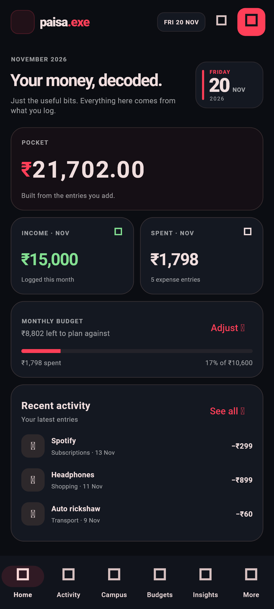
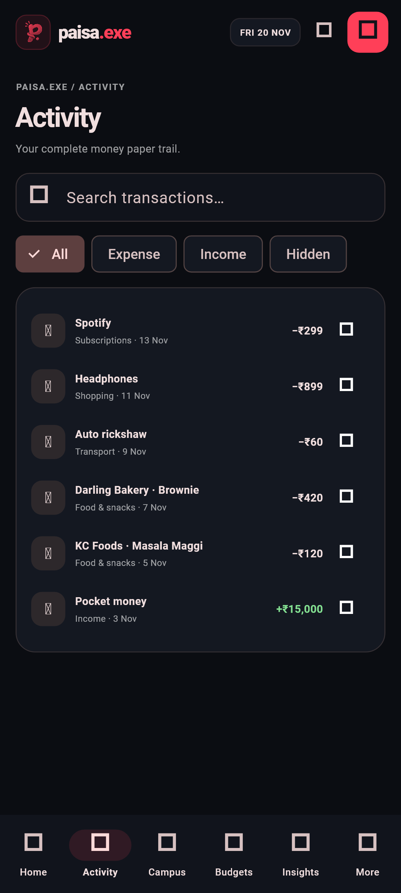
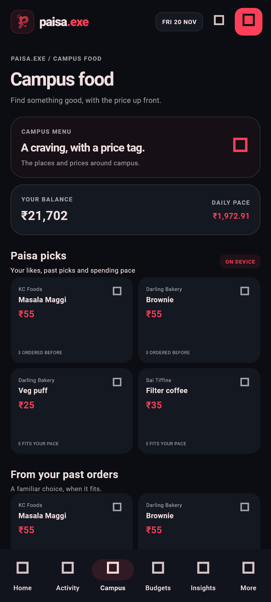
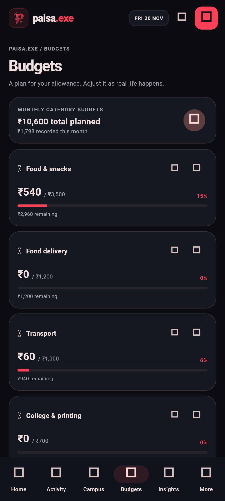
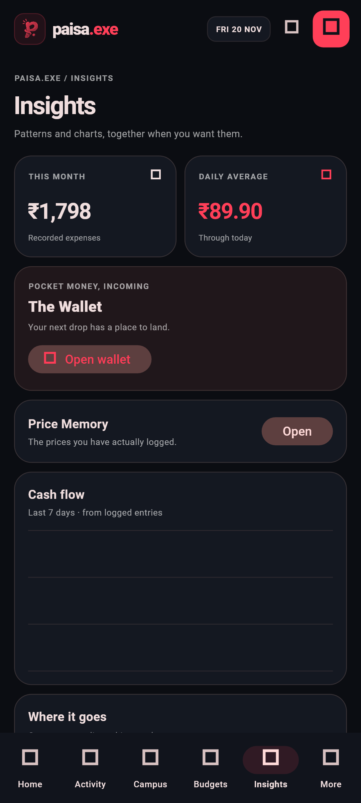
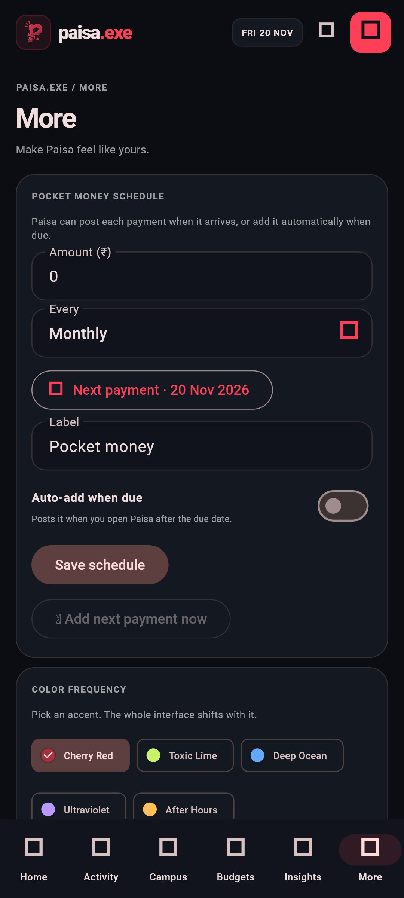

# Paisa.exe

**Your money, decoded.** — an offline-first pocket-money companion for VIT students, built with Flutter.

> Money talks. This one actually listens (and remembers what you spent it on).

Paisa.exe tracks pocket balance, income, expenses, monthly budgets, and recurring pocket money. It keeps a transaction history with monthly insights, exports and imports CSV, remembers prices you have explicitly logged, offers campus food menus for quick entry, and includes **"Your Money Has a Lore"** — a seven-chapter offline story that reacts to your spending patterns and remembers your choices.

No accounts. No cloud. No ads. Your data lives on your phone and nowhere else.

---

## Download

**[⬇ Download Paisa.apk (latest release)](https://github.com/LikhitCodezz/Paisa-exe/releases/latest/download/Paisa.apk)**

### Install on Android

1. Tap the link on your phone (or send the APK to yourself via WhatsApp/Drive).
2. Open the downloaded `Paisa.apk`. If Android says "Install blocked", tap **Settings → Allow from this source** for your browser/file manager, then retry.
3. If you already have an older Paisa.exe installed, **uninstall it first** — Android refuses to overwrite an app signed with a different key.
4. Tap **Install**, then **Open**.

> The APK is signed with the debug keystore for now, so it is meant for sideloading among friends, not the Play Store. Updates replace the old version cleanly as long as the signing key stays the same.

---

## What it does

- Tracks pocket balance, income, expenses, and monthly budgets.
- Records recurring pocket money and shows when the next payment is due.
- Wallet illustration that shifts through six states as your balance changes.
- Transaction history and monthly insights.
- CSV export and import.
- **Price Memory** — item history and place labels for prices you have logged.
- Campus food menus for one-tap logging.
- **Your Money Has a Lore** — a seven-chapter offline story with choices that persist.
- Color themes, hidden amounts, and reduced motion.

---

## Screenshots

| Home | Activity | Campus |
|---|---|---|
|  |  |  |

| Budgets | Insights | Settings (More) |
|---|---|---|
|  |  |  |

## Screens and flow

1. Open the app and set up your starting balance and recurring allowance.
2. Log income or expenses, optionally from a campus food menu.
3. Review the transaction history and monthly insights.
4. Track budgets and watch the wallet illustration reflect your balance.
5. Export a CSV for a real backup, or import one to restore.
6. Optionally hide sensitive transactions behind a PIN.

---

## Technology stack

| Area | Technology | Role |
|---|---|---|
| Framework | Flutter | Cross-platform UI |
| Language | Dart 3.13.5+ | Application logic |
| Persistence | `shared_preferences` | Local key-value storage for the ledger and settings |
| Formatting | `intl` | Date and number formatting |
| Sharing | `share_plus` | CSV export/share |
| Files | `cross_file` | Cross-platform file handling for import/export |
| Android security | Android Keystore (AES-GCM) | Encrypts hidden transactions |
| Analysis | `flutter_lints` | Static analysis rules |

No backend, no authentication service, and no cloud dependency.

---

## Architecture

The app is a small, single-package Flutter project with four core library files:

```
lib/
  main.dart            App entry point, screens, widgets, animations
  paisa_store.dart     Local data, transactions, settings, allowance logic
  lore.dart            Story engine and the seven-chapter arc
  lore_page.dart       Cinematic reader, archive, typewriter reveal
assets/images/         Logo and wallet artwork
android/               Android and Gradle configuration
test/                  Flutter tests
legacy/                Older web version kept for reference
```

- **`PaisaStore`** is the central data layer: it owns the ledger, settings, allowance schedule, and persistence through `shared_preferences`.
- **`lore.dart` / `lore_page.dart`** implement the offline story engine and its cinematic reader.
- **`main.dart`** holds the UI: screens, widgets, animations, and the wallet state illustration.
- Hidden transactions are stored in an encrypted vault using a key held in the Android Keystore.

---

## Getting started

### Prerequisites

- Flutter SDK with Dart **3.13.5+**.
- Android Studio + Android SDK (or any Android device with USB debugging).
- Java 17 (used by the Android Gradle configuration).
- An Android phone or emulator.

### Clone and run

```sh
git clone https://github.com/LikhitCodezz/Paisa-exe.git
cd Paisa-exe
flutter pub get
flutter run
```

Or open the folder in Android Studio and press **Run ▶**.

### Build a release APK

```sh
flutter pub get
flutter build apk --release
```

Output lands at `build/app/outputs/flutter-apk/app-release.apk`. Rename it to `Paisa.apk` if you are publishing it as a release asset.

---

## Data, privacy, and security

- **Storage is local only.** The ledger, settings, and allowance schedule are stored on the device via `shared_preferences`. There is no account and no cloud sync.
- **Hidden transactions** are encrypted with AES-GCM using a key in the Android Keystore. There is no PIN recovery — lose the device or key and they are gone. Treat the PIN as a privacy gate, not a security guarantee.
- **Local app data survives updates** but not uninstalls or "clear storage". Export a CSV if you want a real backup.
- **Offline by design.** No network requests are made for app functionality.

---

## Project status and limitations

- **Offline only.** No cloud sync, no website, no backend wired up yet.
- **Android-focused.** The project targets Android; other platforms are not actively supported or tested.
- **Release builds are signed with the debug keystore**, so they are suitable for sideloading, not the Play Store.
- **No PIN recovery** for hidden transactions.
- **No formal privacy policy document** is included in the repository; the behavior above is what the code implements.

---

## Running tests

```sh
flutter analyze
flutter test
```

The test suite covers the store (allowance cycle, ledger), lore, price memory, transaction privacy, layout, and a smoke test. Run `flutter analyze` before submitting changes.

---

## Contributing

1. Fork the repository.
2. Create a feature branch.
3. Make your changes.
4. Run `flutter analyze` and `flutter test`.
5. Submit a pull request.

Please keep changes focused and follow the existing code style (the project uses `package:flutter_lints`).

---

## Acknowledgements

- Built with [Flutter](https://flutter.dev) and [Dart](https://dart.dev).
- Android Keystore for hidden-transaction encryption.

---

## License

No license file is currently present in the repository. Until one is added, the default copyright terms apply and reuse is not granted. If you intend to open-source this project, add a `LICENSE` file (for example, MIT) at the repository root.

---

Made by **Likhit**. Enjoy your paisa. 🪙