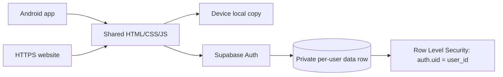

# Paisa.exe

Paisa.exe is an Android-first personal finance app. The companion website is still available, but the current app stores its ledger on the phone and does not require an account.

## Android app

The Android project is in [`android/`](android/). Its native shell opens the app full-screen, saves a copy of the ledger in Android private storage, and includes that copy in Android's backup/restore rules. Android Studio can open that folder directly. Select **Build > Build Bundle(s) / APK(s) > Build APK(s)** to create a debug APK. After editing the app, refresh the packaged assets with:

```bash
npm run build
npm run android:sync
```

The APK is normally created at `android/app/build/outputs/apk/debug/app-debug.apk`. Android may restore the private copy after reinstall when device backup is enabled; this depends on the user's Android backup settings. Keep a CSV export for an independent backup. This project currently provides Android packaging; iOS packaging is not set up.

## Website

Open `index.html` in a current browser for local use, or run `npm run build` and publish `web-dist/` to an HTTPS static website. Before publishing, use the Supabase setup below to enable shared accounts.

## Accounts and shared data

Account sign-in and cloud sync are intentionally out of the current Android app flow. The older Supabase setup below applies only if cross-device website sync is re-enabled later.

1. Create a Supabase project.
2. Run [`supabase/schema.sql`](supabase/schema.sql) in its SQL editor. This creates one private data row per account and enables owner-only Row Level Security policies.
3. Enable email/password sign-in in Supabase Authentication and configure the website URL for confirmation and password reset redirects.
4. Add the Supabase project URL and **publishable key** to `cloud-config.js`. Never put a secret or service-role key in the app.
5. Build and publish `web-dist/` to an HTTPS website. Create an account and sign in on both the Android app and website.

The app keeps a local copy for quick loading and syncs the ledger through Supabase after sign-in. Until Supabase is configured and the user signs in, data stays on that device and does not appear on the other platform. The database stores the ledger payload; this is not end-to-end encryption. Do not enter bank credentials, UPI PINs, or card numbers.

## Features

- Add, edit, delete, search, import, and export transactions.
- Local persistence plus optional account-based cloud sync across devices.
- Monthly category budgets, safe-to-spend guide, dashboard, category spending, and cash-flow chart.
- Purchase simulator, data-backed insights, and monthly Wrapped recap.
- Hide balances, light theme, roast mode, CSV backup, mobile navigation, and reduced-motion support.

## Architecture



The website and Android app use the same frontend and Supabase account. Local browser storage is separate on each device; account sign-in is required for cross-device sync. The database currently stores each account's ledger as one JSON payload. Cloud hosting and app-store publishing require accounts and credentials owned by the maintainer.

## Tests

Run the finance calculation tests with Node.js:

```bash
node --test tests/finance.test.cjs
```

Run `node scripts/copy-web.mjs` to rebuild web assets. `node scripts/copy-android.mjs` copies those assets into the Android project.
